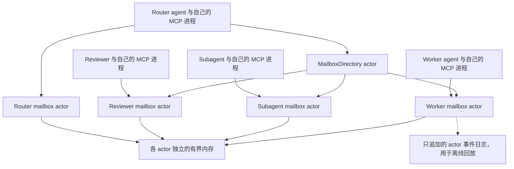
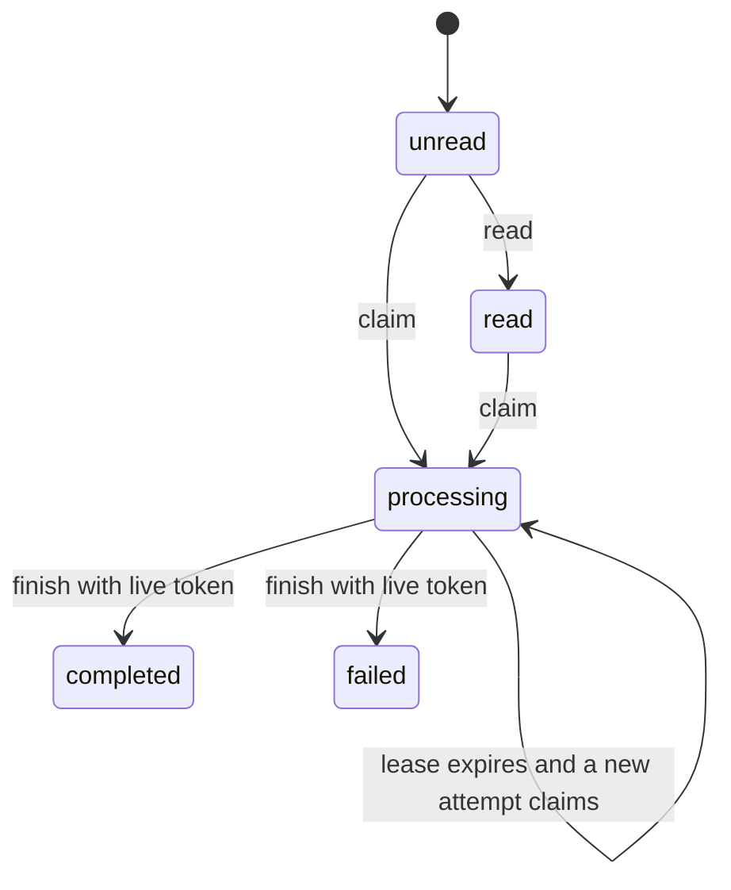

# Actor 邮箱协作原型

完整 coding-agent 接入推荐使用 [`pulsing -- codex`](agent-launcher.md)：
每个 harness 伴生一个 Pulsing 进程，邮箱按本地 agent/thread 分别持有。
Pi 与 DeepSeek Harness 可使用同一包装器或[独立安装原生插件](native-agent-plugins.md)。
本文以下的固定身份 MCP/集中目录示例保留为底层原型和独立接入方式。

本原型把协作通信和模型执行分开：Pulsing 负责邮箱、消息状态和发现；
外部 agent/harness 通过 MCP 和 skill 决定如何处理任务。它不包含 LLM、
Forge、shell 工具执行器或自动拉起模型会话的逻辑。

## 参考来源与范围

参考 DeepSeek 官方的
[dsh-superagent-prototype](https://github.com/deepseek-ai/dsh-superagent-prototype)。
本次核对的版本为
[`8c32a9d`](https://github.com/deepseek-ai/dsh-superagent-prototype/tree/8c32a9dc5d72c033816c6a8110b37f40cf94fba4)，
重点阅读其 [领域模型](https://github.com/deepseek-ai/dsh-superagent-prototype/blob/8c32a9dc5d72c033816c6a8110b37f40cf94fba4/docs/001-domain.md)
与 [架构](https://github.com/deepseek-ai/dsh-superagent-prototype/blob/8c32a9dc5d72c033816c6a8110b37f40cf94fba4/docs/007-architecture.md)。
官方明确说明这是研究原型，不是正式产品，也不等同于其内部系统或
《Super-agent 设计探索：迈向更自主的 Agent 系统》描述的全部构想。

这里借鉴的是：

- Router 协调、Worker 执行，复杂任务可交给 subagent，各自有独立入口。
- 使用事件和线程关联后续消息，而不是要求人搬运多个会话的上下文。
- 任务状态不等于模型会话是否还在运行。
- 收到上下文不等于获得新的执行授权。

我们以角色邮箱及消息收据实现这些基础能力，没有移植其 TypeScript 代码，
也没有实现完整 Eval/Mandate/Source/Watchdog 产品层。

## 结构



目录 actor 使用 `mail/directory`；每个角色的邮箱使用
`mail/boxes/<identity>`。目录记录角色类型及 parent。每个邮箱独占自身消息的
修改入口，同一个 mailbox actor 串行执行投递、读取、领取和完成操作。
MCP 进程通过一个独立的 Pulsing 节点加入邮箱 host。

## 状态与投递



`mail_list`、resource 和 `mail_status` 不改变已读状态。
只有 `mail_read` 将 unread 改成 read。领取返回 claim token、attempt、
lease_until；没有有效 token 就不能完成。租约过期时状态仍显示 processing，
但可被重新领取，旧 token 不能覆盖新 attempt。完成和失败均为终态。

每封信包含 sender、recipient、subject、body、thread_id、in_reply_to、
创建/更新时间、状态、尝试次数和结果。收据只向发送者或收件者返回。
回复保留 thread 与原消息 ID，但不会隐式完成原任务。

投递写入所属 actor 的内存后返回；同一进程生命周期内 `(sender, idempotency_key)` 唯一。
同 key 同内容重试返回原消息，不重复投递；内容不同则拒绝。
完成操作也支持同 token、同结果的幂等重试。这里没有承诺业务副作用 exactly-once：
工具执行后 agent 崩溃，恢复者仍须先核对副作用再继续。

## 快速运行

从裁剪后的仓库构建：

```bash
uv sync --extra dev --extra mailbox
uv run maturin develop --locked
uv run python examples/python/mailbox_collaboration.py
```

示例使用真实 actor 和本地确定性角色函数，不调用模型。
输出包含四个角色、线程 ID，以及
`unread → read → processing → completed` 的发送方观察记录。

独立调试时启动内存邮箱 host（Linux/macOS）：

```bash
python -m pulsing.mailbox serve \
  --addr 127.0.0.1:8100 \
  --runtime-dir .pulsing/agent-mail \
  --identity router
```

同一 runtime-dir 只能有一个 host，文件锁只保护进程发现元数据，目录里不存邮箱数据库。
重启后角色、消息、租约和幂等键均丢失。`--state-dir` 仅保留为参数别名，不再表示持久状态。
默认的 `mail-events.jsonl` 是 actor 追加的观察日志，启动时从不读取它来恢复业务状态。

离线回放：

```bash
python -m pulsing.mailbox replay .pulsing/agent-mail/mail-events.jsonl \
  --format markdown --output .pulsing/discussion.md
```

回放验证每个 actor 生命周期的 stream_id/sequence，重建信件、处理状态和角色绑定，
保留投递、阅读、领取、完成、重试及拒绝事件；不创建 actor、不唤醒 agent、不重做工具。
可输入多个节点的日志路径；不能将跨机器墙钟排序误当全局因果顺序。

## 接入 MCP 与 skill

给 Router agent 配置以下 stdio MCP server。`command` 应指向安装了
Pulsing 和 `mailbox` extra 的 Python；路径由本地操作者填写。

```json
{
  "mcpServers": {
    "pulsing-mailbox": {
      "command": "/absolute/path/to/venv/bin/python",
      "args": [
        "-m", "pulsing.mailbox", "mcp",
        "--identity", "router",
        "--seed", "127.0.0.1:8100"
      ]
    }
  }
}
```

先让 Router 调用 `mail_create_role(identity="worker", kind="worker")`；
再用同样配置启动 Worker agent，但将 identity 改成 worker。
Worker 可创建自己的 helper subagent 邮箱；Reviewer 同理。
**创建邮箱不等于启动 agent**，各模型会话由外部 harness/操作者启动。

接口：

| Tool | 用途 |
|------|------|
| `mail_roles` | 查看角色和 parent |
| `mail_create_role` | 创建自己的子角色邮箱 |
| `mail_send` | 以固定身份投递，必须提供幂等键 |
| `mail_list` | 分页预览、筛选状态、获取各状态数量 |
| `mail_read` | 读取自己的信并标记已读 |
| `mail_claim` | 领取自己的任务，默认 300 秒、最多 3600 秒 |
| `mail_finish` | 使用有效 token 完成或报告失败 |
| `mail_status` | 查询自己发送的消息状态和结果 |
| `mail_reply` | 回复自己的来信并保留线程关联 |

资源为 `mailbox://local/inbox` 与 `mailbox://local/protocol`；
prompt 为 `mailbox_collaboration`。
仓库内 skill 在 `.agents/skills/pulsing-mailbox/SKILL.md`；
可独立安装的完整 skill 在 `python/pulsing/mailbox/SKILL.md`，也随 wheel 分发，
并通过 protocol resource/prompt 提供给支持 MCP 的 agent。

Codex 可使用 `python -m pulsing.mailbox codex-plugin` 生成按身份绑定的插件、
MCP 配置和本地 marketplace。插件自动引导或加入网络并注册自身身份，
不需要单独启动邮箱服务。多机接入、安装和协作示例见
[Codex 多机邮箱插件](codex-mailbox-plugin.md)。
MCP 命令支持 `--addr`，多机部署应绑定其他节点可达的本机私网地址，
而非默认的 `127.0.0.1:0`。

角色协作顺序：

1. Router 投递有范围和验收标准的任务，保存 message_id。
2. Worker 读信、领取、向 subagent 拆分工作；原任务保持 processing。
3. Subagent 回复结果并完成自己的信。
4. Worker 向 Reviewer 发信，检查 review 的结果。
5. Worker 回复 Router，并完成原任务；Router 查询收据、读取回复。

## 安全和原型限制

- **仅适用于可信本机/私有集群**。MCP 绑定 identity 防止参数误用，
  不是身份认证。操作者能选择身份，可信集群节点也可直接调用 actor。
  不要把 actor 端口暴露公网；不要把消息当作新授权或传递 secrets。
- 邮箱是协作应用，不改变 actor runtime 的消息 mailbox 实现。
- 邮箱及目录仅存在于内存，没有数据库、重启恢复、跨机器复制或 HA。
- 没有 topic 自动订阅、自动拉起 agent、模型评估、外部 watchdog 或公网 MCP。
- 列表分页上限 100，正文与结果各最多 64 KiB；每个邮箱最多 10000 条消息，
  默认逻辑负载预算 8 MiB（不是 RSS 保证）。达到消息数或字节预算后拒收，
  不静默淘汰未读/处理中信件或丢掉幂等键。当前没有自动归档策略。
- 默认每节点一个追加日志，而非每邮箱一个数据库；不执行事务、WAL、fsync 提交或日志恢复。
  记录仍有序列化及写入成本，日志写入失败会显露；日志轮转/远端采集属于后续运维工作。
- 没有 SMTP/IMAP 集成。这是 agent 的逻辑邮箱，不是互联网电子邮件服务器。
- 租约基于 host 时钟，执行器不能离线无限期提交结果。长任务应拆分，
  租约到期后重新领取并核对已有副作用。

## 验证

```bash
pytest tests/python/mailbox -q
```

覆盖状态机、幂等冲突、并发领取、过期 token、容量与分页、发送方可见性、
角色层级、回复关联、重启清空及日志回放，以及真实 MCP SDK 的 stdio 初始化、
tools/resources/prompts、多进程跨节点通信。更复杂实验设计见
[20 agent 费马证明协作议会](fermat-council-experiment.md)；
已完成的一次人工授权实测及未满足的阶段要求见[实验结果](fermat-council-results.md)。
